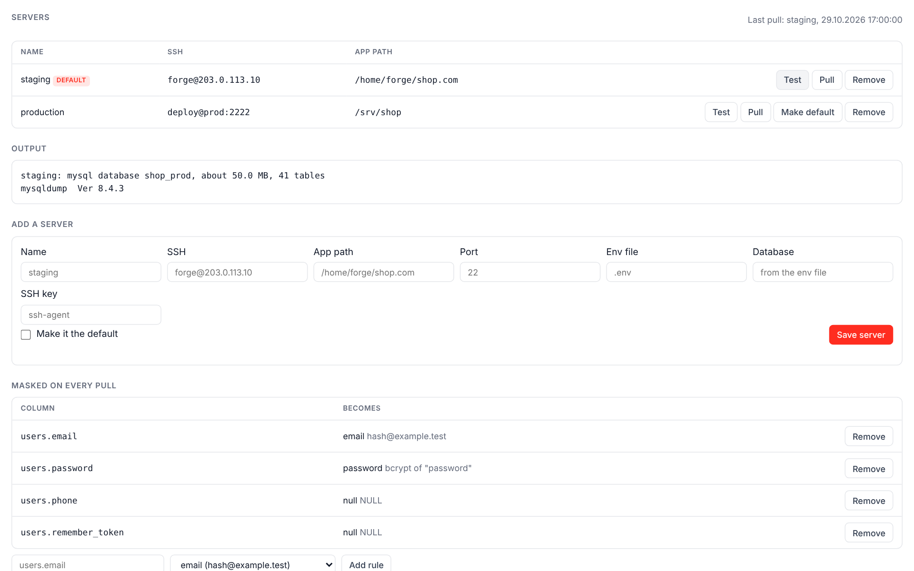

# db-pull for Lerd

> Pull a site's database from your staging or production server into
> [Lerd](https://lerd.sh) over SSH, with personal data masked on the way in.



```bash
lerd plugin install https://github.com/yellow-three/lerd-plugin-db-pull
cd ~/code/shop
lerd db-pull:add staging forge@203.0.113.10 /home/forge/shop.com
lerd db-pull:mask users.email email
lerd db-pull:skip sessions telescope_entries
lerd db-pull:pull
```

The dump runs on the server and reads the database settings from the app's own `.env` there, so the server's database password never leaves it and Lerd never asks for one. Before replacing anything, the site's Lerd database is snapshotted as `before-db-pull`, so `lerd db:restore before-db-pull` undoes a pull. A dump that fails halfway is thrown away, and a masking rule that fails fails the pull, so unmasked data is never left behind silently.

It works from the terminal, from the site's **Commands** menu and **DB Pull** tab in the dashboard, and for AI assistants through Lerd's MCP server as `db-pull_remotes` and `db-pull_pull`. MySQL, MariaDB and PostgreSQL are supported.

## What it adds to Lerd

| Surface | What |
|---|---|
| Commands | `db-pull:add`, `db-pull:remotes`, `db-pull:remove`, `db-pull:test`, `db-pull:pull`, `db-pull:mask`, `db-pull:skip` |
| Site command | **Pull database from server**, in the site's Commands menu |
| Site tab | **DB Pull**: the site's servers, Test and Pull, masking rules and skipped tables |
| MCP tools | `db-pull_remotes` and `db-pull_pull`, with a skill for assistants |
| API endpoints | `config`, `test` and `pull`, all `loopback_only`, used by the site tab |

No hooks, no page scripts, no notifications, no services or frameworks.

## What it reads, changes and sends

**Reads.** Lerd's site list through its API (`/api/sites`), for the site's path, database name and database service. On the server you saved, the app's env file (`.env` unless you set another), because that is where the database name, host, user and password are: the script that reads it runs on the server, and only the database's name, engine, size and table names and the dump tool's version come back, never the password. It does not read your local `.env`. Your SSH keys are used by `ssh` itself, from ssh-agent or the key file you saved with `--identity`; the plugin never opens them.

**Changes.** The site's database in Lerd, only when you pull, and only through Lerd's own commands: `lerd db:create`, `lerd db:snapshot before-db-pull`, `lerd db:import --fresh`, then `lerd db:import` of the masking statements. Its own settings, one JSON file per site in the data folder Lerd gives it, holding server addresses, app paths and rules but no password. The dump passes through a temporary file in that same folder and is deleted when the pull ends, whether it succeeded or not. Nothing on the server is changed: the dump only reads, and its temporary option file is removed on exit.

**Sends.** Only to the servers you save yourself with `db-pull:add` or the site tab, over SSH: a POSIX shell script (in [`lib/remote.js`](lib/remote.js)) that reads the env file and runs `mysqldump`, `mariadb-dump` or `pg_dump`. The dump comes back over the same connection. Nothing else leaves your machine: no analytics, no other hosts. Lerd's API token is only sent to Lerd's own API.

The full instructions are in [DOCS.md](DOCS.md), which Lerd also shows on the plugin's **Documentation** tab.

## Requirements

- Lerd 1.38 or newer, on Linux or macOS (Windows through WSL)
- Node.js and `ssh` on your machine
- On the server: SSH access with a key, `mysqldump`/`mariadb-dump` or `pg_dump`, and `gzip`

## Development

```bash
npm test
lerd plugin install .
```

Everything it runs is plain Node.js and a POSIX shell script sent to the server, with no dependencies.

## License

MIT
